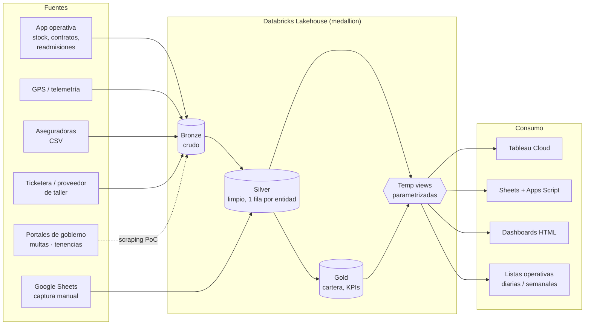

<div align="center">

# 🚗 Fleet Analytics Portfolio

**Diego Coste** · Fleet Analytics & Data Business Partner · Ciudad de México

Pipelines, modelos analíticos y dashboards para la operación de una flota de **miles de vehículos** en ~15 ciudades de México:
cobranza y recuperación, multas y tenencias, siniestros, talleres, gestoría vehicular y venta de unidades (desflote).


</div>

---

> [!NOTE]
> **Portafolio anonimizado.** Todo el código proviene de proyectos reales, pero los nombres de tablas, catálogos, proveedores, personas y cifras de negocio fueron reemplazados o eliminados. Los datos de ejemplo son **sintéticos**. Ver [política de anonimización](docs/anonimizacion.md).

## 🧭 Cómo navegar este repo

| Si te interesa… | Empieza aquí |
|---|---|
| Ver el panorama en 2 minutos | La tabla de proyectos de abajo ⬇️ |
| Arquitectura de datos | [`docs/arquitectura.md`](docs/arquitectura.md) |
| Cómo pienso un análisis (discovery → plan A/B) | [`docs/metodologia-discoveries.md`](docs/metodologia-discoveries.md) |
| SQL reutilizable (IQR, dedup con prioridad, flujos con `LAG`, días hábiles…) | [`docs/patrones-sql.md`](docs/patrones-sql.md) |
| Código Python probado con tests | [`src/fleetlib/`](src/fleetlib) · [`tests/`](tests) |
| Correr algo en local en 1 minuto | [Quickstart](#-quickstart) |

## 📂 Proyectos

| # | Proyecto | Problema de negocio | Lo técnico destacado | Stack |
|---|---|---|---|---|
| 01 | [**Cobranza & Strategic Recovery**](projects/01-cobranza-recovery) | Dar a Cobranza y Recovery listas de trabajo diarias/semanales mientras la plataforma se actualiza | Vistas self-service parametrizadas, matriz de transición de buckets, funnel a legal, flujo semanal con `LAG()` | Spark SQL |
| 02 | [**Multas & Tenencias**](projects/02-multas-tenencias) | ¿Qué tenemos y qué no? ¿De quién es cada multa? ¿Cómo dejamos de capturar a mano? | Línea de tiempo por unidad para atribuir responsable, cobertura por estado, folios duplicados, PoC de extracción automatizada | PySpark · SQL · Playwright |
| 03 | [**Desflote (venta de unidades)**](projects/03-desflote) | Medir el embudo de venta de autos fuera de flota y proyectar cierres | Funnel multietapa, regla semana→mes por jueves, forecast vs real, dashboard HTML comercial, PRD de ~56 requerimientos | SQL · Sheets · Apps Script · HTML |
| 04 | [**Siniestros**](projects/04-siniestros) | Consolidar reportes de 2 aseguradoras y detectar unidades atoradas | Dedup con prioridad de estatus, cruce con GPS, medianas IQR por segmento, 7 hallazgos accionables | Spark SQL · Sheets |
| 05 | [**Talleres — Discoveries**](projects/05-talleres) | Unidades detenidas en taller sin trazabilidad entre sistemas | Match de 3 sistemas por VIN, selección de estadístico según distribución, exposición de cashflow, cola de conciliación | PySpark · Plotly |
| 06 | [**Gestoría — KPIs**](projects/06-gestoria-kpis) | Medir al proveedor de trámites vehiculares con metas justificadas por datos | 5 pilares / 15 KPIs, días hábiles con calendario LFT, metas derivadas de percentiles maduros | PySpark · Matplotlib |
| 07 | [**Legal Tracker**](projects/07-legal-tracker) | Tablero operativo del área Legal (backlog, entradas, salidas, recuperaciones) | Universo legal por cruce NUC × cartera, paginación en Tableau con visibilidad dinámica | SQL · Tableau |
| 08 | [**Geoespacial & GPS**](projects/08-geoespacial) | Asignar vehículos a patios/talleres y medir recencia de GPS | H3 res. 9 con expansión k-ring, umbral de recencia validado en P25, DBSCAN, heatmaps | PySpark · H3 · Folium |
| 09 | [**Cargadores EV**](projects/09-cargadores-ev) | Operación de cargadores domiciliarios sin control | Diagnóstico de proceso de 9 etapas, inventario por códigos de barras, MVP nativo en lakehouse | Python · pyzbar · draw.io |
| 10 | [**BI Design System**](projects/10-bi-design-system) | Dashboards inconsistentes entre analistas | Kit de Tableau: tema, paletas, plantilla base, checklist de publicación de 19 puntos | Tableau |

## 🏗️ Arquitectura general



**Principios que se repiten en todos los proyectos**

- **VIN como llave maestra** entre sistemas; todo cruce se valida con cobertura de match antes de reportar.
- **Temp views parametrizadas** (`params` CTE con `fecha_inicial` / `fecha_final`) en lugar de tablas persistentes mientras el producto madura.
- **Fecha de corte explícita** en cada análisis: nada de `current_date()` escondido en una cifra que se presenta.
- **Cada número reproducible**: reglas de negocio documentadas por escrito antes de construir la métrica.
- **Hallazgo → Conclusión → Plan A (raíz) / Plan B (contener y operar)** como formato de entrega.

## ⚡ Quickstart

```bash
git clone https://github.com/diegcoste/fleet-analytics-portfolio.git
cd fleet-analytics-portfolio
python -m venv .venv && source .venv/bin/activate   # Windows: .venv\Scripts\activate
pip install -e ".[dev]"

python data/synthetic/generate.py      # genera CSVs sintéticos en data/synthetic/out/
pytest -q                              # corre los tests de la librería
python -m fleetlib.demo                # demo: atribución de multas + regla semana→mes + mediana IQR
```

## 🗂️ Estructura

```
.
├── docs/                    # arquitectura, metodología, patrones SQL, anonimización
├── projects/                # 10 proyectos, cada uno con README + sql/ + notebooks/ + docs/
├── src/fleetlib/            # lógica de negocio reutilizable en Python puro (testeada)
├── tests/                   # pytest
├── data/synthetic/          # generador de datos falsos para correr ejemplos
└── .github/workflows/ci.yml # lint + tests en cada push
```

## 🧰 Habilidades demostradas

| Área | Evidencia |
|---|---|
| **Modelado de datos** | Medallion, vistas por grano (unidad / multa / contrato), explode de `ARRAY<STRUCT>`, `max_by`, NULL-safe joins |
| **Analítica** | IQR, selección de percentil por forma de distribución, matrices de transición, cohortes por mes de asignación |
| **Ingeniería** | PySpark, Unity Catalog, puente pandas↔Spark, parámetros, tests, CI |
| **Geoespacial** | H3 + k-ring, DBSCAN, heatmaps por código postal |
| **BI / producto** | Tableau (visibilidad dinámica, design system), Sheets avanzado (`LET`/`LAMBDA`/`MAP`), Apps Script, PRDs |
| **Negocio** | Traducción de datos a decisiones para Fleet, Cobranza, Recovery, Legal, Risk y Dirección |

## 📬 Contacto

¿Preguntas sobre algún proyecto? Abre un *issue* o escríbeme por LinkedIn.

---

<sub>Licencia MIT para el código. El contenido de documentación es de uso libre con atribución.</sub>
