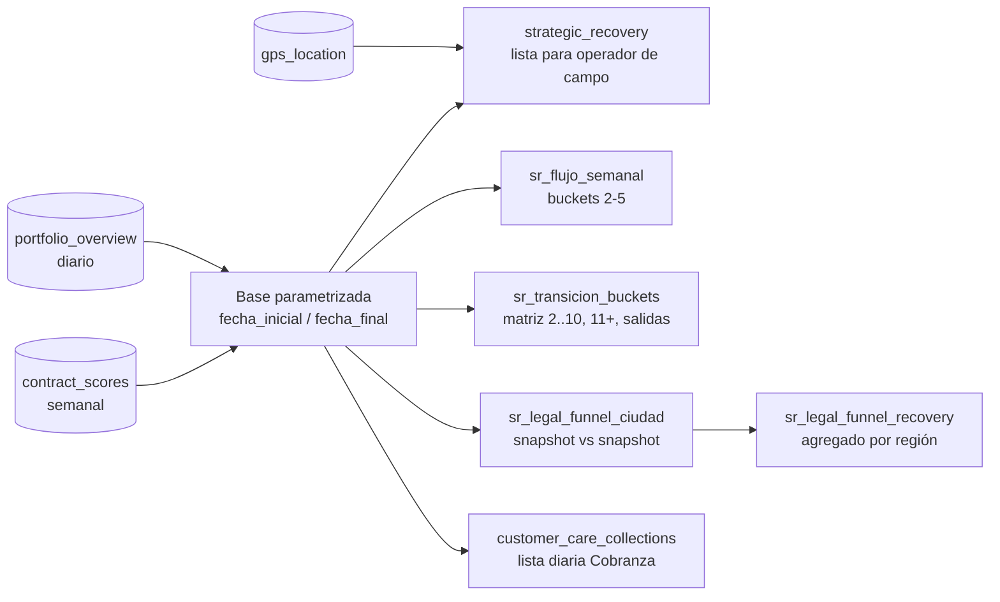

# 01 · Cobranza & Strategic Recovery

> Vistas self-service en Databricks para que los líderes de **Cobranza** (atraso temprano) y **Recovery** (atraso avanzado / recuperación de unidad) asignen y trabajen la cartera mientras la plataforma de cobranza se adapta a su operación.

## Contexto

| | |
|---|---|
| **Usuarios** | Cobranza (lista diaria), Recovery de campo (lista semanal), Dirección (KPIs por ciudad) |
| **Dependencias** | Risk actualiza semanalmente la tabla de scores/bandas |
| **Compromisos de entrega** | Base de resultados de Recovery cada martes · lista de Recovery cada miércoles · lista de Cobranza diaria |
| **Fuente** | `lakehouse.gold.portfolio_overview` (cartera diaria), `lakehouse.risk.contract_scores`, GPS, contacto |
| **Persistencia** | Solo *temp views* — ninguna tabla creada |

## Qué resuelve

## Reglas de negocio (resumen)

| Regla | Definición |
|---|---|
| **Band NUEVO** | Contrato con ≤ 28 días desde inicio → `NUEVO`, tiene prioridad sobre el score |
| **Band A–D** | > 28 días: última band disponible (`max_by(band, week_date)`) — A Protect · B Manage · C Test · D Recover |
| **Sin band** | > 28 días y sin score → se excluye de la lista |
| **Segmento Recovery** | bucket 1–2 `RETENER` · 3 `REACTIVAR` · 4–10 `REDEFINIR R/R` · ≥ 11 `LEGAL` |
| **Región de recuperación** | Agrupa `vehicle_state` en 4 regiones operativas (centro, noreste, noroeste, occidente) |
| **Acción Cobranza** | Matriz band × `dpd` → Seguimiento / Cobranza / Regularización |

Detalle completo: [`docs/reglas_negocio.md`](docs/reglas_negocio.md).

## Archivos

| Archivo | Qué hace |
|---|---|
| [`sql/01_params_y_base.sql`](sql/01_params_y_base.sql) | Parámetros de fechas, región, band vigente |
| [`sql/02_flujo_semanal.sql`](sql/02_flujo_semanal.sql) | Flujo inicial · entradas · salidas · final por semana con `LAG()` |
| [`sql/03_matriz_transicion.sql`](sql/03_matriz_transicion.sql) | Matriz de transición de buckets entre dos snapshots |
| [`sql/04_legal_funnel.sql`](sql/04_legal_funnel.sql) | Funnel hacia legal por ciudad/municipio y por región |
| [`sql/05_vista_strategic_recovery.sql`](sql/05_vista_strategic_recovery.sql) | Lista operativa con GPS y contacto aplanados para el operador |

## Decisiones técnicas

- **Parametrizar en lugar de auto-detectar el martes.** La primera versión calculaba la fecha de corte buscando el martes más reciente; cambió a `fecha_inicial` / `fecha_final` explícitas para poder reconstruir cualquier periodo y auditar resultados pasados.
- **`11+` colapsado** en columnas y filas de la matriz: después del bucket 11 el caso es legal y el detalle por bucket deja de ser accionable.
- **`recuperaciones` como columna propia**: contratos que desaparecen de la cartera entre snapshots se separan de `salidas` (bucket 0–1) porque representan la unidad ya recuperada.
- **`ARRAY<STRUCT>` → columnas planas** para teléfonos y últimas posiciones GPS: el usuario final trabaja en Sheets y no puede leer estructuras anidadas.
- **Filtros NULL-safe** (`<=>`, `coalesce`) para que contratos sin GPS o sin score no desaparezcan silenciosamente.
