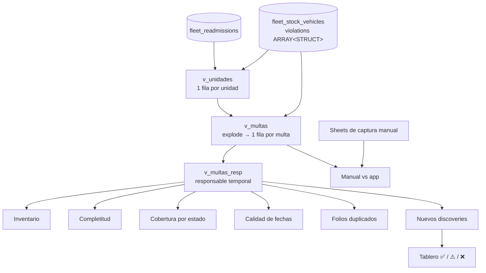

# 02 · Multas & Tenencias

> EDA y diagnóstico de cobertura de multas vehiculares y tenencias/refrendos de toda la flotilla: **qué tenemos, qué no tenemos, de quién es cada multa** y cómo pasar de captura manual a obtención automática.

## Preguntas que responde

1. ¿Cuántas multas hay, cuánto suman y cuánto sigue sin pagar?
2. ¿A quién le corresponde cada multa: cliente actual, cliente anterior, periodo sin cliente o antes de que la unidad fuera nuestra?
3. ¿Qué estados reportan multas y cuáles son un hueco de información?
4. ¿Coincide lo que el equipo captura a mano con lo que la app operativa trae sola?
5. ¿Cómo automatizamos la consulta en portales de gobierno?

## Estructura del análisis

## Atribución de responsable (el corazón del análisis)

Cada multa se ubica en la **línea de tiempo** de su unidad (recepción → entregas → readmisiones):

| Caso | Responsable |
|---|---|
| La multa es anterior a `reception_date` | `antes_recepcion` (error de la entidad: la unidad aún no era de la empresa) |
| Unidad nunca entregada, o multa antes de la primera entrega | `sin_cliente` |
| Multa después de una readmisión y antes de la siguiente entrega | `sin_cliente` |
| Multa dentro de la ventana [entrega_n, readmisión_n) que no es la última | `cliente_anterior` |
| Multa posterior a la última entrega, sin readmisión después | `cliente_actual` |

Hay dos implementaciones:

- **Versión completa (PySpark)** — reconstruye todas las ventanas de cliente con `explode` de entregas + join por rango contra readmisiones: [`notebooks/clasificacion_responsable.py`](notebooks/clasificacion_responsable.py).
- **Versión simple (SQL)** — usa solo la última entrega y la última readmisión; suficiente para el tablero de cobertura: [`sql/01_vistas_base.sql`](sql/01_vistas_base.sql).
- **Versión en Python puro con tests** — [`src/fleetlib/responsibility.py`](../../src/fleetlib/responsibility.py).

## Discoveries destacados (cualitativos)

| Tipo | Discovery |
|---|---|
| ⚠️ Parcial | Solo una minoría de los estados con flotilla tiene multas cargadas — el resto es **ausencia de consulta**, no flotilla limpia |
| ⚠️ Parcial | `last_violation_check` vacío en buena parte de la flota: muchas unidades "sin multas" en realidad **nunca se consultaron** |
| ⚠️ Parcial | Estatus `unknown` concentrado en procesos de carga específicos |
| ⚠️ Parcial | Folios repetidos en varias unidades: misma fecha y monto → probable duplicado; distinto → el folio no sirve como llave |
| ✅ Tenemos | El saldo abierto se reparte casi a partes iguales entre cliente actual y clientes anteriores → la recuperación debe segmentarse |
| ❌ No tenemos | Concepto, autoridad emisora, fecha de pago, fecha de captura, placa al momento, ubicación, evidencia, quién pagó |

## Automatización (en curso)

- **Mapeo de portales** de consulta por entidad (tipo de dato, requisitos, captcha, acceso empresarial): [`docs/mapeo_portales.md`](docs/mapeo_portales.md).
- **PoC de extracción** con Playwright + BeautifulSoup + pandas hacia una tabla homologada: [`scraping/`](scraping).
- **Proceso de excepciones**: re-correr consultas fallidas con reglas y dejar al equipo de Fleet solo el residual manual.
- **Convenios con entidades** para recibir datos por API en lugar de extraerlos.

## Archivos

| Archivo | Contenido |
|---|---|
| [`sql/01_vistas_base.sql`](sql/01_vistas_base.sql) | `v_unidades`, `v_multas`, `v_multas_resp` |
| [`sql/02_cobertura.sql`](sql/02_cobertura.sql) | Inventario, completitud, cobertura y huecos de carga por estado |
| [`sql/03_calidad_y_folios.sql`](sql/03_calidad_y_folios.sql) | Fechas imposibles, montos, folios duplicados, consistencia de línea de tiempo |
| [`sql/04_discoveries.sql`](sql/04_discoveries.sql) | ¿Sin multas o sin consultar?, unidades fuera de flota con deuda, antigüedad, rezago de captura |
| [`notebooks/clasificacion_responsable.py`](notebooks/clasificacion_responsable.py) | Modelo temporal completo en PySpark |
| [`scraping/extractor_poc.py`](scraping/extractor_poc.py) | PoC de extracción a esquema homologado |
