# 03 · Desflote — venta de unidades fuera de flota

> Pipeline, dashboard comercial y documentación de producto para el proceso de **desflote**: unidades que salen de la flota y se venden a compradores (B2B). Del Google Sheet operativo a un dashboard HTML comercial y a una migración formal a la plataforma de ventas + Tableau.

## Qué se construyó

| Entregable | Descripción |
|---|---|
| **Export `DBX_DATA_DESFLOTE`** | Query plana en Databricks que alimenta el Sheet; se reemplaza in-place en cada refresh |
| **Workbook operativo** | Hojas `INVENTARIO`, `OFERTAS`, `HISTORIAL_VENTAS`, `COLA_COBRANZA`, `AUXILIARES`, `ALIMENTADOR` |
| **Funnel multietapa** | Disponible → con oferta → asignada → en proceso → facturada → cobrada |
| **Proyección** | Modelo por marca × ciudad con promedios móviles + tabla *forecast vs real* |
| **Apps Script `tableroSemanal()`** | Arma la tabla semanal de forecast y ventas con deduplicación y regla semana→mes |
| **Dashboard comercial HTML** | Inventario de hoy, acumulados, asignaciones y SLA, resultados del mes con selector |
| **Paquete de producto** | PRD (~56 requerimientos), brief ejecutivo, presentación C-level, clasificación de variables, diagrama de flujo, `CONTEXT.md` |

## Arquitectura

```mermaid
flowchart LR
  DBX[(Databricks<br/>stock + contratos + ofertas)] -->|export plano| RAW[DBX_DATA]
  RAW --> ALIM[ALIMENTADOR]
  OF[OFERTAS<br/>captura comercial] --> AUX
  INV[INVENTARIO] --> AUX[AUXILIARES<br/>columnas derivadas]
  ALIM --> AUX
  AUX --> F[Funnel] & P[Proyección marca×ciudad] & S[tableroSemanal&#40;&#41;<br/>Apps Script]
  S --> FV[Forecast vs real]
  AUX --> H[Dashboard HTML comercial]
```

**Decisión de arquitectura clave:** todas las columnas derivadas o de lookup viven en `AUXILIARES`. Las hojas fuente nunca se tocan, así un refresh (`Ctrl+A → Supr → pegar`) no rompe ninguna fórmula.

## Reglas de negocio

| Regla | Definición |
|---|---|
| **Semana → mes** | Una semana (lun–dom) pertenece al mes en el que cae su **jueves** (equivalente a ISO-8601). Evita que una semana partida cuente en dos meses. Implementación testeada: [`fleetlib.calendar.week_to_month`](../../src/fleetlib/calendar.py) |
| **Valor por condición** | Referencia = OLV × 80 % (Buena), 70 % (Media), 35 % (Mala). Impacto = precio de venta − referencia |
| **Venta cerrada** | Cobradas + facturadas por cobrar. **Total comprometido** = ventas cerradas + en proceso |
| **SLA de venta** | Días de asignación a cobro; solo unidades cobradas (los meses recientes se marcan como inmaduros) |
| **Prioridad de precio** | Oferta autorizada → oferta pendiente → OLV de inventario (fallback) |

## Archivos

| Archivo | Contenido |
|---|---|
| [`sql/dbx_data_desflote.sql`](sql/dbx_data_desflote.sql) | Export plano para el Sheet |
| [`sheets/formulas.md`](sheets/formulas.md) | Fórmulas clave: prioridad con `SUMPRODUCT`, vistas con `FILTER`/`CHOOSECOLS`, clasificación con `LET`/`LAMBDA` |
| [`apps-script/tableroSemanal.gs`](apps-script/tableroSemanal.gs) | Tabla semanal de forecast y ventas |
| [`docs/prd_resumen.md`](docs/prd_resumen.md) | Resumen del PRD de migración a la plataforma de ventas |
