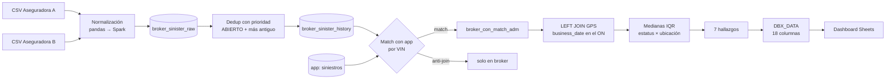

# 04 · Siniestros — consolidación de aseguradoras y hallazgos

> Unifica los reportes de siniestros de **dos aseguradoras** con la app operativa y el GPS para responder: ¿dónde están físicamente las unidades siniestradas, cuánto tiempo llevan ahí y cuáles están atoradas?

## Flujo

## Decisiones técnicas

- **Lectura de CSV desde `/Workspace/`** vía pandas → `spark.createDataFrame`, porque Unity Catalog bloquea la lectura directa de Spark sobre rutas de Workspace.
- **Normalización de VIN/serie**: quitar *todo* whitespace (`regexp_replace(x, '\\s+', '')`) y `upper`; los reportes de aseguradora traen espacios intermedios.
- **Dedup**: si un VIN tiene un siniestro ABIERTO, gana el abierto (y entre abiertos, el más antiguo); si no, el más reciente.
- **GPS**: triple nulo en campos de ubicación → `SIN GPS`; nulo en geocerca → `NOT IN GEOFENCE`.
- **Outliers por segmento**: límites IQR por `estatus × location_bucket`, no globales; un taller y un patio tienen distribuciones de días muy distintas.

## Los 7 hallazgos

| # | Segmento | Lectura |
|---|---|---|
| 1 | CERRADO · en taller | Siniestro cerrado pero la unidad sigue físicamente en taller |
| 2 | CERRADO · fuera de geocerca | Cerrado y la unidad no está en ninguna ubicación controlada |
| 3 | ABIERTO · en patio | Abierto con la unidad parada en patio propio |
| 4 | ABIERTO · taller · pérdida total | Pérdida total que sigue ocupando espacio en taller |
| 5 | ABIERTO · taller · valuación/reparación · > 1 mes | Reparación que excede el tiempo esperado |
| 6 | ABIERTO · taller · valuación/reparación · ≤ 1 mes | Mismo segmento, dentro de tiempo (control) |
| 7 | ABIERTO · fuera de geocerca o sin GPS · pérdida total | Pérdida total sin ubicación conocida |

## Archivos

| Archivo | Contenido |
|---|---|
| [`notebooks/carga_brokers.py`](notebooks/carga_brokers.py) | Lectura y normalización de CSV de aseguradoras |
| [`sql/01_broker_consolidacion.sql`](sql/01_broker_consolidacion.sql) | Unión, dedup con prioridad, match / anti-join con la app |
| [`sql/02_gps_iqr.sql`](sql/02_gps_iqr.sql) | Join con GPS y medianas IQR por segmento |
| [`sql/03_hallazgos_dbx_data.sql`](sql/03_hallazgos_dbx_data.sql) | Export plano de 18 columnas con la marca de hallazgo |
| [`docs/checklist_app_prd.md`](docs/checklist_app_prd.md) | Resumen del PRD de la App de Siniestros / Checklist |
