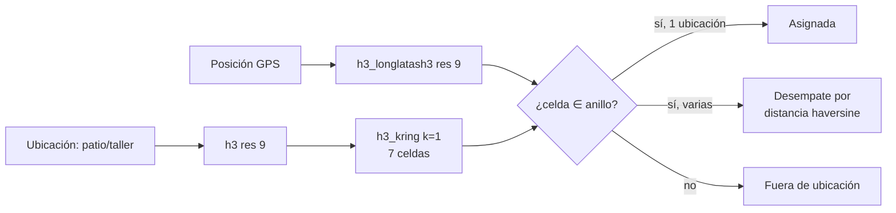

# 08 · Geoespacial & GPS

> Análisis espacial de la flota: asignación de vehículos a patios y talleres con **H3**, segmentación por recencia de GPS cruzada con riesgo y atraso de la cartera, clustering con **DBSCAN** y heatmaps por código postal.

## Piezas

| Pieza | Qué resuelve | Técnica |
|---|---|---|
| **Asignación a ubicaciones** | ¿En qué patio/taller está cada unidad? | H3 resolución 9 + expansión **k-ring** |
| **Recencia de GPS** | ¿Qué GPS dejaron de reportar? | Umbral de **14 días** validado estadísticamente (≈ P25 de la distribución de inactivos) |
| **GPS × riesgo × atraso** | ¿Las unidades sin GPS son las de mayor riesgo? | Join vehículo + referencia de riesgo + historial de DPD |
| **Clusters de proximidad** | Concentraciones de unidades para rutas de recuperación | DBSCAN con métrica haversine |
| **Heatmaps** | Densidad por código postal | Folium |

## Por qué k-ring y no match exacto de celda

El match exacto de celda H3 fallaba cuando la unidad estaba a pocos metros del centro de la ubicación pero caía en el hexágono **adyacente**. Expandir la celda de la ubicación con `h3_kring(cell, 1)` (la celda + sus 6 vecinas) resolvió los falsos negativos sin abrir tanto el radio como para generar asignaciones dobles; cuando una unidad cae en el anillo de dos ubicaciones, gana la de menor distancia haversine.

## Archivos

| Archivo | Contenido |
|---|---|
| [`notebooks/h3_kring_matching.py`](notebooks/h3_kring_matching.py) | Asignación con funciones H3 nativas de Databricks |
| [`notebooks/gps_recency_dbscan.py`](notebooks/gps_recency_dbscan.py) | Segmentación de recencia, validación del umbral y DBSCAN |
