# 09 · Cargadores EV — diagnóstico y MVP operativo

> La operación de cargadores domiciliarios para vehículos eléctricos no tenía un sistema de control: inventario incompleto, asignaciones sin rastro y pagos a proveedor sin conciliar. Se diagnosticó el proceso, se reconstruyó el inventario y se propuso un MVP nativo en el lakehouse.

## Proceso actual (9 etapas)

```mermaid
flowchart LR
  A[01 Visita domiciliaria<br/>evaluación en campo] --> B[02 Elegibilidad<br/>Risk aprueba]
  B --> C[03 Venta<br/>Sales cierra]
  C --> D[04 Adquisición e inventario<br/>captura de cargadores]
  D --> E[05 Lista de ventas<br/>match cliente–cargador]
  E --> F[06 Confirmación de cita<br/>CX agenda]
  F --> G[07 Asignación<br/>Fleet asigna]
  G --> H[08 Instalación<br/>proveedor en domicilio]
  H --> I[09 Pago al proveedor<br/>conciliación]
```



## Lo que se hizo

| Pieza | Detalle |
|---|---|
| **Diagnóstico** | Dónde se rompía la plataforma actual en cada etapa: dueño, sistema y dato faltante |
| **Inventario físico** | Lectura de números de serie desde ~100 fotografías combinando decodificación de códigos de barras (`pyzbar`, CODE128) con lectura visual para los ilegibles; salida validada en CSV |
| **MVP propuesto** | Tablas en el lakehouse por etapa (inventario, asignación, instalación, pago) con VIN + serie del cargador como llave; visualización en Tableau Cloud |
| **Diagrama** | Flujo de 9 etapas en draw.io |

## Snippet: lectura de códigos de barras en lote

```python
from pathlib import Path
import csv
from PIL import Image
from pyzbar.pyzbar import decode, ZBarSymbol

rows = []
for img in sorted(Path("fotos").glob("*.jp*g")):
    codes = decode(Image.open(img), symbols=[ZBarSymbol.CODE128])
    if not codes:
        rows.append({"archivo": img.name, "serie": "", "metodo": "revisar_visual"})
    for c in codes:
        rows.append({"archivo": img.name, "serie": c.data.decode(), "metodo": "barcode"})

with open("inventario_cargadores.csv", "w", newline="", encoding="utf-8") as f:
    w = csv.DictWriter(f, fieldnames=["archivo", "serie", "metodo"])
    w.writeheader(); w.writerows(rows)
```

Las imágenes sin lectura se marcan `revisar_visual` y se validan a mano; al final se deduplica por serie y se cruzan contra la lista de compras.
